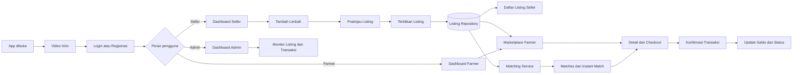
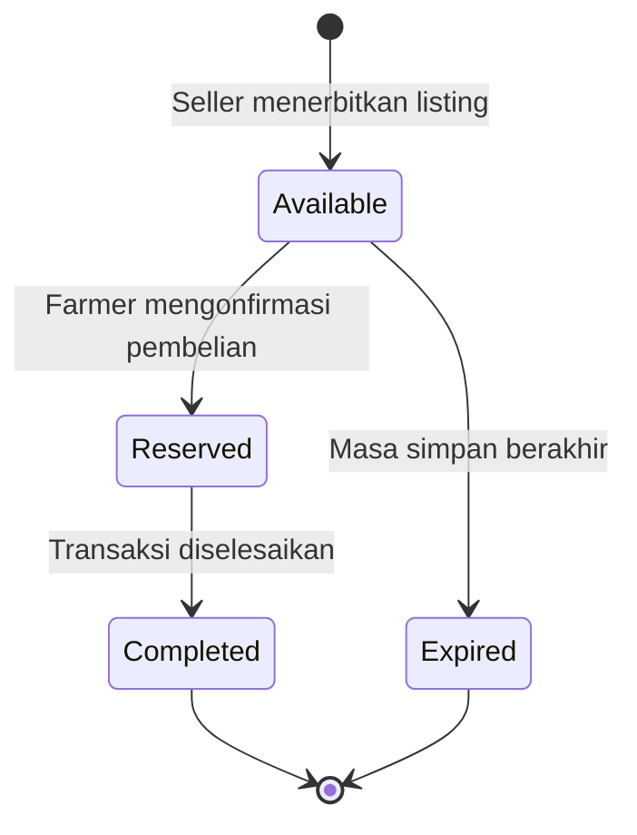
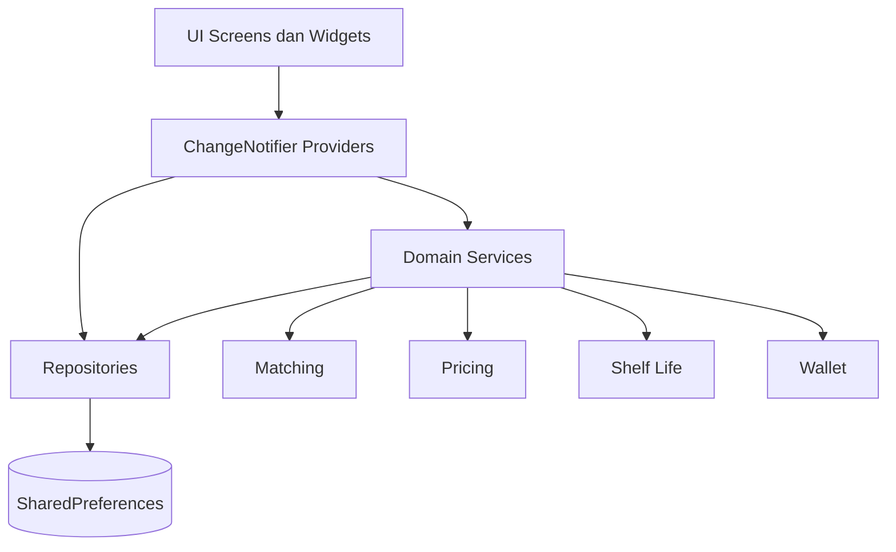
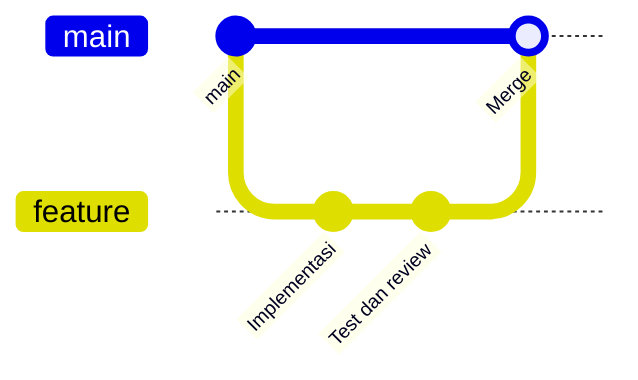

<div align="center">


# 🌾 LINAKAN

### Marketplace Limbah Pangan untuk Peternak

**Menghubungkan seller limbah pangan dengan peternak melalui marketplace, sistem pencocokan, dompet digital, dan transaksi yang terintegrasi.**

<p>
  
  
  
  
</p>

<p>
  
  
  
  
  
</p>

</div>

---

## 📖 Tentang LINAKAN

**LINAKAN** adalah aplikasi Flutter yang membantu mengubah limbah pangan menjadi sumber pakan yang lebih bernilai. Seller seperti bakery, industri rumah tangga, dan UMKM dapat menerbitkan listing limbah. Peternak dapat melihat produk tersebut di Marketplace, memperoleh rekomendasi berdasarkan kecocokan, lalu melakukan transaksi melalui dompet simulasi.

Project ini menggunakan pendekatan **offline first**. Data akun, profil, listing, transaksi, dan sesi pengguna disimpan secara lokal menggunakan `shared_preferences`.

### Peran pengguna

| Peran | Fungsi utama |
|---|---|
| 🏪 **Seller** | Membuat listing limbah, mengelola produk, memantau transaksi, dan melihat pendapatan. |
| 🐄 **Farmer** | Menjelajahi Marketplace, melihat Instant Match, membeli limbah, dan mengelola transaksi. |
| 🛡️ **Admin** | Memantau listing dan transaksi serta mengekspor data operasional. |

---

## ✨ Fitur Utama

### 🔐 Autentikasi

- Registrasi berdasarkan peran seller atau farmer.
- Login menggunakan nomor telepon atau email dan password.
- Verifikasi OTP simulasi.
- Intro dan onboarding hanya dijalankan pada alur registrasi baru.
- Akun yang sudah terdaftar langsung menuju dashboard setelah login.

### 📦 Listing Limbah

- Seller membuat dan melihat pratinjau listing sebelum diterbitkan.
- Harga rekomendasi dihitung berdasarkan kategori dan berat.
- Berat minimum listing adalah 2 kg.
- Listing baru langsung tersimpan pada daftar seller.
- Listing aktif tersedia pada Marketplace farmer.
- Listing yang kompatibel ikut tampil pada halaman Matches farmer.

### ⚡ Matching Farmer

- Skor kategori berdasarkan kecocokan jenis ternak.
- Skor lokasi dihitung menggunakan jarak Haversine.
- Skor kapasitas menyesuaikan kebutuhan mingguan farmer.
- Listing dengan skor minimal 85% memperoleh label **Instant Match**.
- Marketplace tetap menampilkan seluruh listing aktif sehingga farmer dapat menemukan dan membeli produk di luar rekomendasi utama.

### 💳 Dompet dan Transaksi

- Top up dan penarikan saldo dalam bentuk simulasi.
- Biaya platform sebesar 5%.
- Saldo farmer berkurang dan saldo seller bertambah ketika transaksi dikonfirmasi.
- Status listing berubah mengikuti lifecycle transaksi.

### 🎨 Pengalaman Pengguna

- Video logo 9:16 tampil pada pembukaan aplikasi.
- Font utama **Poppins**.
- Warna dasar off white dengan aksen biru solid `#6DA6EF`.
- Tampilan memadukan skeuomorphism ringan dan glassmorphism.
- Shadow dibatasi secara halus dengan opasitas sekitar 5%.
- Ikon bertema agrikultur digunakan pada aksi utama.

---

## 🔄 Workflow Aplikasi



### Lifecycle listing



### Alur data



---

## 🧱 Arsitektur dan Struktur Kode

Project memisahkan tampilan, state, aturan bisnis, dan penyimpanan agar setiap bagian lebih mudah dikembangkan dan diuji.

```text
linakan_dumy/
├── android/                       # Konfigurasi native Android
├── ios/                           # Konfigurasi native iOS
├── macos/                         # Konfigurasi native macOS
├── web/                           # Entry point dan manifest web
├── assets/
│   ├── images/                    # Gambar intro, profil, dan ilustrasi
│   ├── logo/                      # Logo utama LINAKAN
│   └── videos/                    # Video intro aplikasi
├── docs/                          # Catatan fitur seller dan farmer
├── lib/
│   ├── main.dart                  # Bootstrap service, repository, dan provider
│   ├── app.dart                   # MaterialApp dan konfigurasi GoRouter
│   ├── core/
│   │   ├── constants/             # Warna, teks, surface, dan aturan bisnis
│   │   ├── services/              # AuthService dan StorageService
│   │   ├── theme/                 # Tema global Flutter
│   │   └── utils/                 # Formatter, animasi, CSV, dan Haversine
│   ├── data/
│   │   ├── models/                # Model seller, farmer, listing, dan transaksi
│   │   ├── repositories/          # Akses dan persistensi data lokal
│   │   └── seeds/                 # Data awal aplikasi
│   ├── domain/
│   │   ├── matching_service.dart  # Perhitungan kecocokan listing
│   │   ├── pricing_service.dart   # Harga rekomendasi dan biaya platform
│   │   ├── shelf_life_service.dart# Masa simpan dan status kedaluwarsa
│   │   └── wallet_service.dart    # Saldo dan pemrosesan transaksi
│   ├── providers/                 # State aplikasi menggunakan ChangeNotifier
│   └── ui/
│       ├── admin/                 # Dashboard dan pengelolaan admin
│       ├── auth/                  # Video intro, login, OTP, dan registrasi
│       ├── common/                # Navigasi dan widget reusable
│       ├── farmer/                # Dashboard, Matches, Marketplace, checkout
│       ├── seller/                # Dashboard, pembuatan listing, transaksi
│       └── wallet/                # Layar dompet bersama
├── test/
│   ├── domain/                    # Unit test aturan bisnis
│   └── providers/                 # Test autentikasi dan visibilitas listing
├── pubspec.yaml                   # Dependency dan registrasi asset
└── analysis_options.yaml          # Aturan static analysis
```

### Tanggung jawab setiap layer

| Layer | Tanggung jawab |
|---|---|
| 🖼️ **UI** | Menampilkan data, menerima input, dan mengirim aksi pengguna. |
| 🔄 **Provider** | Mengelola state, loading, error, dan sinkronisasi antarlayar. |
| 🧠 **Domain** | Menjalankan aturan matching, pricing, shelf life, dan wallet. |
| 🗃️ **Repository** | Membaca serta menyimpan model dalam format JSON. |
| 💾 **Storage** | Persistensi lokal menggunakan SharedPreferences. |

---

## 🧮 Aturan Bisnis

| Aturan | Nilai |
|---|---:|
| Berat minimum listing | **2 kg** |
| Radius rekomendasi match | **15 km** |
| Ambang Instant Match | **≥ 85%** |
| Biaya platform | **5%** |
| Masa simpan roti kering | **14 hari** |
| Masa simpan tepung afkir | **14 hari** |
| Masa simpan sisa makanan olahan | **24 jam** |
| Masa simpan sayuran mentah | **48 jam** |
| Bobot kategori | **40%** |
| Bobot lokasi | **40%** |
| Bobot kapasitas | **20%** |

---

## 🛠️ Teknologi yang Digunakan

| Teknologi | Penggunaan |
|---|---|
| **Dart** | Bahasa pemrograman utama. |
| **Flutter** | Framework antarmuka lintas platform. |
| **Provider** | State management berbasis `ChangeNotifier`. |
| **GoRouter** | Routing dan redirect autentikasi. |
| **SharedPreferences** | Database lokal sederhana untuk mode demo. |
| **Video Player** | Memutar video intro dari asset lokal. |
| **Google Fonts** | Memuat keluarga font Poppins. |
| **Phosphor Icons** | Ikon antarmuka pendukung. |
| **FL Chart** | Grafik statistik dashboard. |
| **Flutter Animate** | Transisi dan motion antarmuka. |

---

## 🚀 Menjalankan Project

### Prasyarat

- Flutter SDK `3.29.3` atau versi kompatibel.
- Dart SDK `>=3.0.0 <4.0.0`.
- Android Studio, Xcode, Chrome, atau perangkat yang didukung Flutter.

### Instalasi

```bash
git clone https://github.com/OrganicoconutSugar/Linakan.git
cd Linakan
flutter pub get
flutter run
```

Untuk memilih perangkat tertentu:

```bash
flutter devices
flutter run -d <device-id>
```

### Pemeriksaan kualitas

```bash
flutter analyze
flutter test
```

### Build

```bash
# Android APK
flutter build apk

# Android App Bundle
flutter build appbundle

# Web
flutter build web
```

---

## 🧪 Strategi Pengujian

- **Domain test:** matching, pricing, shelf life, dan wallet.
- **Provider test:** autentikasi dan distribusi listing lintas peran.
- **Widget test:** dashboard, profil, navigation bar, listing card, dan wallet header.
- **Responsive test:** memastikan card tetap aman pada beberapa lebar layar.

Salah satu skenario integrasi lokal memastikan satu listing baru seller tersedia pada:

1. Daftar listing milik seller.
2. Marketplace farmer.
3. Matches farmer ketika kompatibel.

---

## 🌿 Workflow Pengembangan



1. Buat branch fitur dari `main`.
2. Kerjakan perubahan dalam ruang lingkup kecil.
3. Jalankan `flutter analyze` dan `flutter test`.
4. Commit dengan pesan yang menjelaskan perubahan.
5. Push branch dan lakukan review sebelum digabungkan ke `main`.

---

## 🎨 Design System

| Token | Nilai | Penggunaan |
|---|---|---|
| Primary | `#6DA6EF` | Tombol, navigasi aktif, dan highlight. |
| Primary soft | `#E1ECFB` | Chip, bidang ikon, dan state lembut. |
| Background | `#F1F4F6` | Warna dasar halaman. |
| Surface | `#F8FAFB` | Card dan lembar konten. |
| Text | `#203342` | Teks utama. |
| Font | `Poppins` | Seluruh tipografi aplikasi. |

Warna biru digunakan sebagai warna solid tanpa gradasi. Logo ditampilkan tanpa bidang atau bayangan tambahan.

---

## ⚠️ Batasan Versi Demo

- Belum menggunakan backend atau sinkronisasi cloud.
- OTP, top up, pembayaran, dan penarikan saldo masih berupa simulasi lokal.
- Lokasi tersimpan sebagai data profil dan belum memakai pelacakan real time.
- Data akan mengikuti penyimpanan lokal pada perangkat yang menjalankan aplikasi.

---

<div align="center">

### 💙 LINAKAN

**Dari limbah pangan, menuju pakan yang lebih bernilai.**

<sub>Dibangun menggunakan Flutter dan Dart.</sub>

</div>
